# KEV Radar

[](https://github.com/Dexious123/kev-radar/actions/workflows/tests.yml)
[](runtime.txt)
[](LICENSE)

Built by **Juan Martinez**.

KEV Radar is a remediation-ops console. It answers what is due under [CISA BOD 26-04](https://www.cisa.gov/news-events/directives/bod-26-04-prioritizing-security-updates-based-risk), who owns it, whether the team will miss the SLA, and which Windows KB would fix a Microsoft CVE.

That first question got harder in June 2026, when BOD 26-04 replaced BOD 22-01. A KEV due date is no longer the deadline. Each finding gets its own clock, set by the asset as well as the CVE, so the same CVE can be due in 3 days on an internet-facing host and in 60 on an internal one. KEV Radar works out that deadline for every host and CVE, then tracks it against the team's actual close rate. It runs on a fictional estate, so anyone can open it with no login and no scanner account.

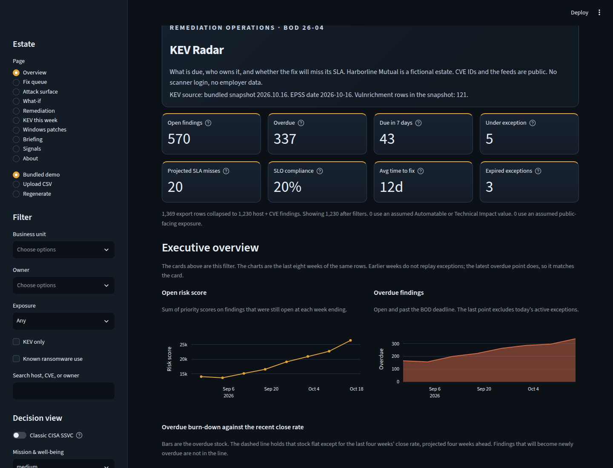

## Why this matters

BOD 22-01 is revoked. On June 10, 2026 CISA replaced it, and BOD 19-02, with BOD 26-04. The new directive sets a remediation clock from four facts: is the asset publicly exposed, is the CVE in the KEV catalog, is exploitation automatable, and is the technical impact total or partial. The outcome is 3 days plus forensic triage, 3 days, 14 days, 60 days, or fix on the next system upgrade.

A catalog explorer stops at "this CVE is in KEV." A SOC lead still has to answer which host, which owner, which deadline, and whether last month's close rate will clear the ones due next week. KEV Radar is built for that second question. The estate is **Harborline Mutual**, a fictional lab: 300 hosts on `*.lab.invalid`, real CVE IDs, and no employer data.

The screenshots show the October 16, 2026 snapshot. That day the lab had 1,230 host-and-CVE findings. 570 are still open. Five sit under an active exception, so the overdue count is 337. 43 are due in the next 7 days. At 23.5 closes a week, about 20 of those 43 are projected to miss. Average time to fix on closed findings is 12 days. SLO compliance sat near 20% because open historical KEVs are already past a clock that started when CISA added them. That is the backlog, not a rounding error. The data refreshes daily, so the live figures move from these.

## Architecture

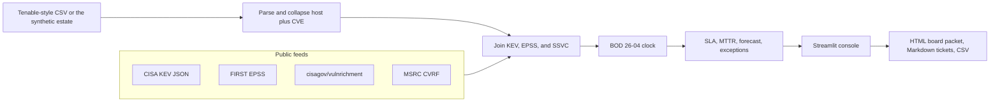

The app reads `data/snapshots/` first. A fresh snapshot does not call the network. An uploaded CVE that is missing from the Vulnrichment file is fetched from the [cisagov/vulnrichment](https://github.com/cisagov/vulnrichment) repository and cached for a day. A 404 keeps CISA's missing-data fallback and the row is marked assumed.

## Feature tour

**Executive overview.** Headline KPIs, an eight-week risk trend, a burn-down of overdue findings against the recent close rate, and a top-10 list with a one-line reason for each.

**Fix queue.** Every open finding carries the BOD 26-04 decision path and the deadline that path produces. The priority score sorts the queue. It does not replace the deadline.

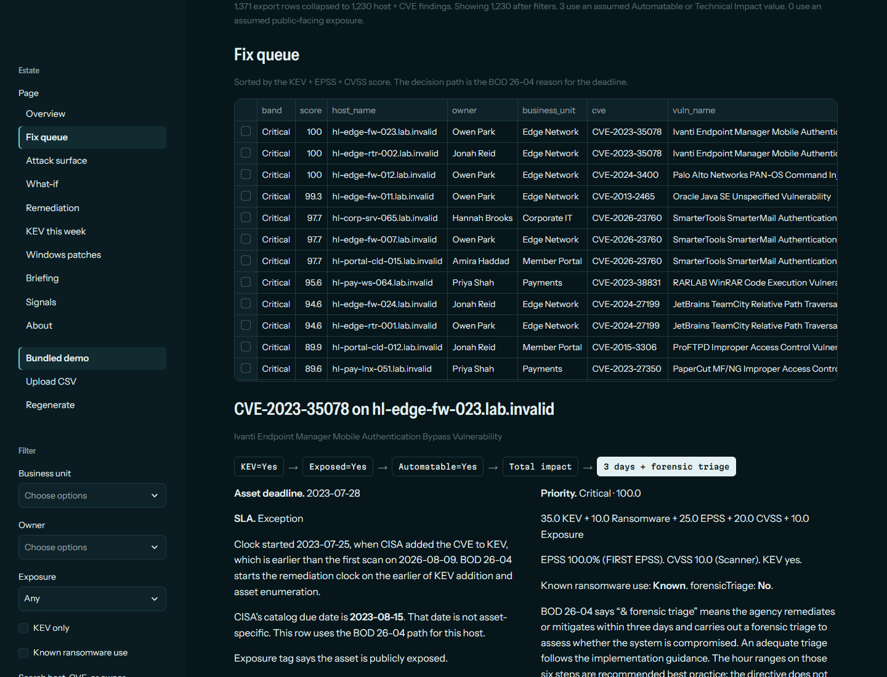

**Attack surface.** Open findings by business unit, split into four lanes: internal or exposed, crossed with KEV or not. Color is mean EPSS. Pick a host and every finding on it is listed with its decision path.

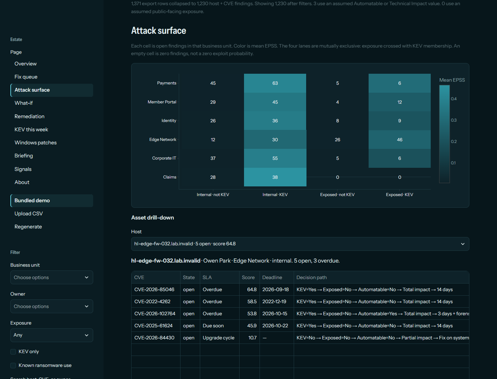

**What-if.** Select findings, a CVE, or a Microsoft KB. Overdue count, portfolio risk, and the 7-day breach sketch update as if those open rows were gone. The historical close rate stays the rate the team has already demonstrated.

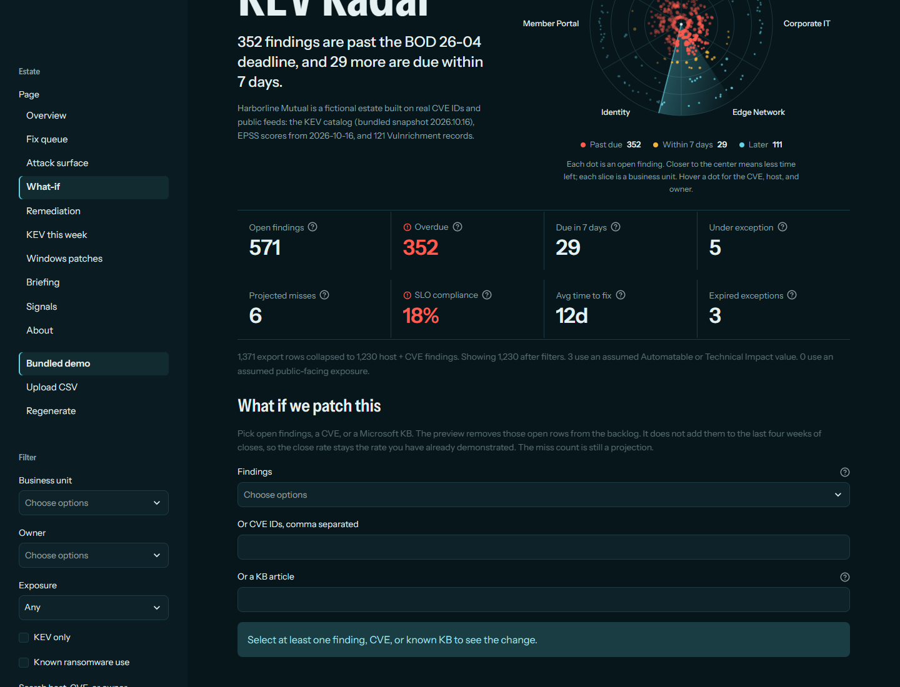

**Remediation and the exceptions register.** Aging, time to fix, SLO, and the forecast. An exception needs an owner, a justification, compensating controls, an expiry, and an approver. An active exception pauses breach counting through the expiry date. Import and export the register as CSV or JSON. The register lives in your own browser session, so visitors to a shared deployment never see each other's entries. On a single-user install, set `KEV_RADAR_OPERATOR_FILE=1` to keep it in `data/operator/exceptions.json` (gitignored) across restarts.

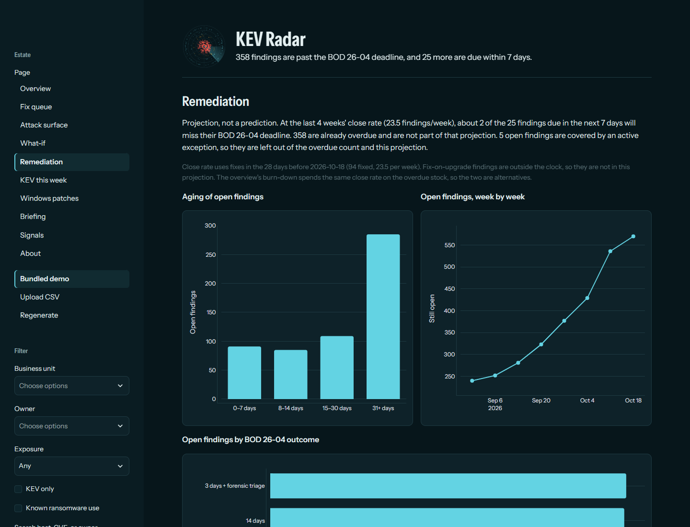

**KEV this week.** Catalog additions from the last 7 days that hit the estate, with `knownRansomwareCampaignUse` and `forensicTriage`. A missing triage field is labeled "Not in this feed."

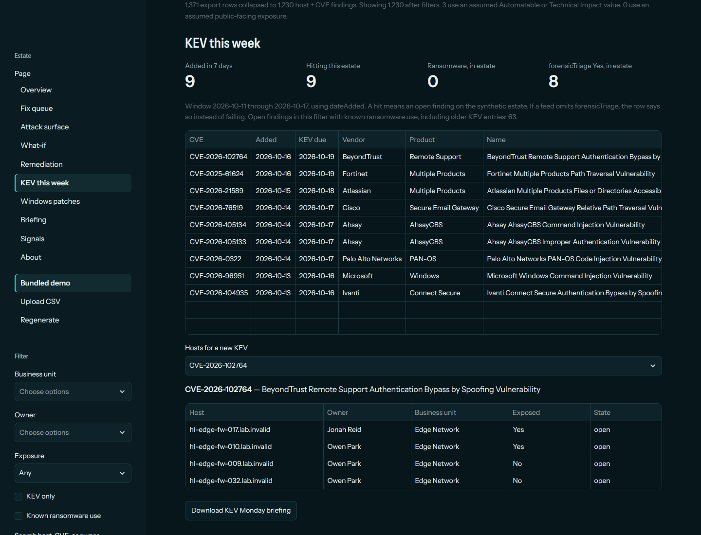

**Windows patches.** Microsoft CVEs map to KB articles from the [MSRC CVRF API](https://api.msrc.microsoft.com/cvrf/v3.0/swagger/v3/swagger.json). The page downloads a read-only PowerShell audit (`Get-HotFix` and `Get-CimInstance Win32_QuickFixEngineering`). The script never installs or removes anything, and the app never runs it.

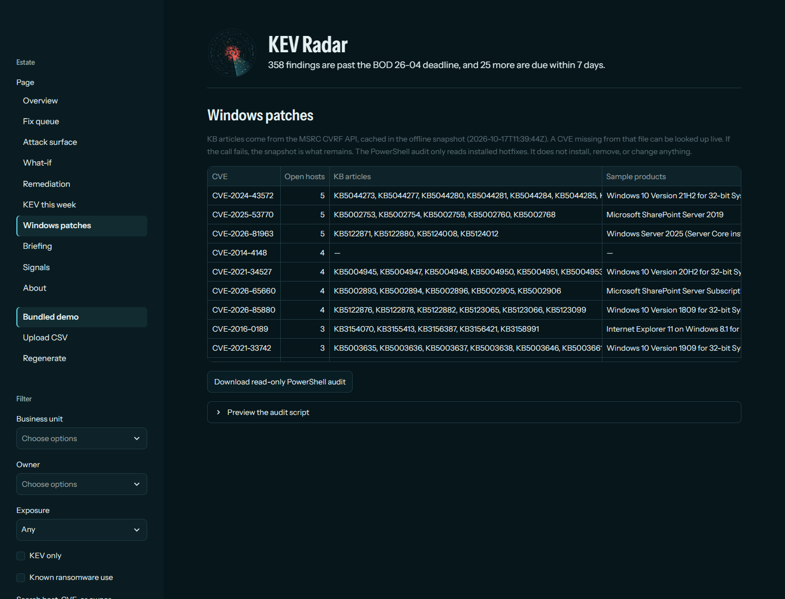

**Briefing.** An offline template writes an executive note and per-owner tickets. A checker rejects any CVE, hostname, or number that is not in the queue data. A live model runs only if you paste a key for that session. Nothing is written to disk.

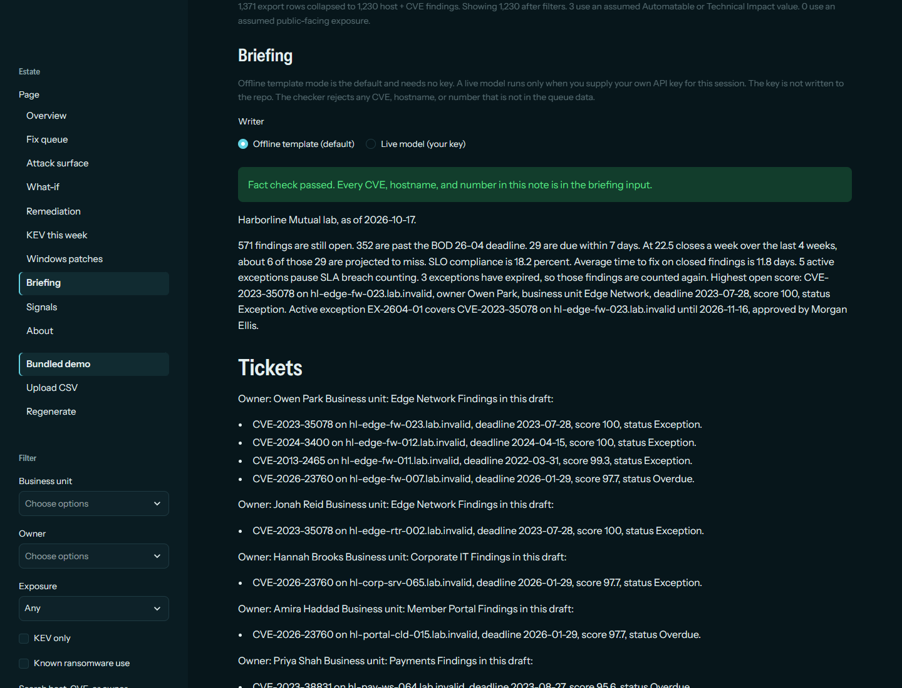

**Signals.** EPSS against CVSS, top vendors among open KEV findings, and monthly catalog additions. A sidebar toggle shows classic CISA SSVC. Deadlines stay on the BOD clock.

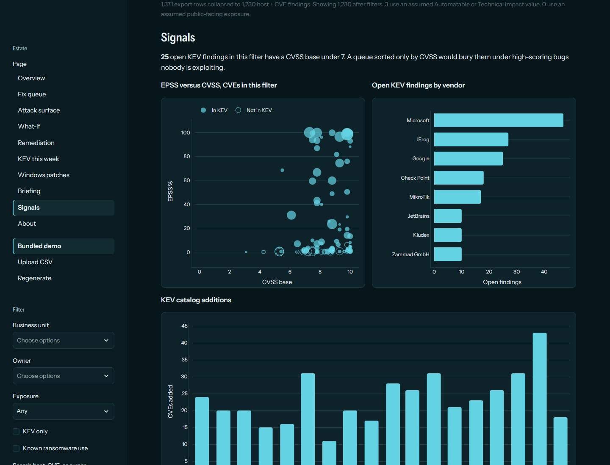

**Exports.** From the overview: a print-ready HTML board packet (use the browser's Print to PDF), GitHub- or Jira-ready Markdown tickets, and a findings CSV.

The About page cites the directive, the implementation guidance, and the CERT/CC table.

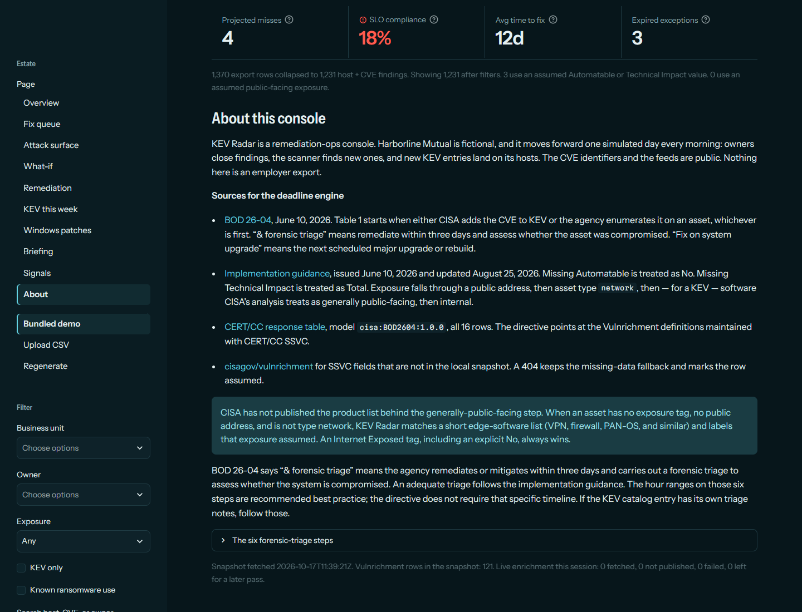

## How scoring works

The score sorts the queue. It is a weighted sum on a 0–100 scale:

| Input | Points |
|---|---|
| CVE is in the KEV catalog | 35 |
| KEV records known ransomware use | 10 |
| FIRST EPSS | up to 25 (EPSS × 25) |
| CVSS base | up to 20 (CVSS / 10 × 20) |
| Asset is publicly exposed | 10 |

EPSS is clamped to 0–1. A scanner value above 1 is treated as a percent. CVSS is clamped to 0–10. A missing EPSS or CVSS contributes 0 and the breakdown says so. Bands are labels only: Critical ≥ 70, High ≥ 40, Medium ≥ 15, otherwise Low. The scanner CVSS wins over Vulnrichment. Scanner EPSS is used only when FIRST has no score.

## How the BOD 26-04 clock works

Each finding walks four decision points: in KEV, publicly exposed, automatable, technical impact. The sixteen outcomes are CERT/CC model `cisa:BOD2604:1.0.0` ([the response table](https://certcc.github.io/SSVC/howto/cisa_response/)). The directive points at those Vulnrichment definitions.

The clock starts on the earlier of two events, quoted from the directive: CISA adds the CVE to the KEV catalog, or the agency enumerates it on the asset. In this app, first seen stands in for that enumeration. The due date itself is still on time. Overdue starts the next day. Fix-on-upgrade rows have no day count and stay out of SLO and the breach forecast.

Exposure, when the agency has not tagged the asset, follows the [implementation guidance](https://www.cisa.gov/news-events/directives/bod-26-04-implementation-guidance-prioritizing-security-updates-based-risk) (updated August 25, 2026):

1. An explicit Internet Exposed tag wins, including No.
2. Else a publicly routable address is public.
3. Else asset type `network` is public.
4. Else, for a KEV, if the software is generally public-facing, treat the asset as public.
5. Else internal.

CISA has not published the product list behind step 4. KEV Radar matches a short edge-software list (VPN, firewall, PAN-OS, and similar) and marks that exposure **assumed**. Set an Internet Exposed tag to override it.

If Automatable is missing, it is treated as No. If Technical Impact is missing, it is treated as Total. Both are marked assumed. The guidance states that fallback for CVEs that are not in KEV. The app uses the same stand-in when a KEV has no enrichment yet, and says so on the row.

When the path says "3 days + forensic triage," the requirement is the directive's: remediate within three days and assess whether the asset was compromised. The six steps and their hour ranges are the guidance's recommended practice. The directive does not require those hour targets. If the KEV entry has its own triage notes, follow those.

The 7-day breach line is a projection. It is findings due in the next week, minus the closes expected from the last four weeks. Already-overdue findings and active exceptions are outside that sentence.

Assumptions, the operator register, and the snapshot layout are written down in the [design notes](docs/DESIGN.md).

## Run it locally

Python 3.12.

```bash
python -m venv .venv
source .venv/bin/activate
pip install -r requirements.txt
streamlit run streamlit_app.py
```

The app opens on the bundled CSV. Use the sidebar to upload another Tenable Vulnerability Management export, or regenerate the lab from a seed. Tests and lint:

```bash
pip install pytest ruff
ruff check .
python -m pytest -q
```

Refresh the offline snapshot (needs network access to CISA, FIRST, MITRE, NVD, and MSRC):

```bash
python scripts/refresh_snapshots.py
```

`--rotate` copies the current KEV catalog onto the previous snapshot before downloading. `--msrc-only` refreshes just the KB snapshot from the CVE pool already on disk.

On a warm process the bundled snapshot loads in a few hundredths of a second, scoring 1,230 findings takes about 70 ms, and the CSV parse (about 0.8 s) is cached for the day so page changes do not repeat it.

## Streamlit Community Cloud

`streamlit_app.py` is the entry point, `requirements.txt` pins the runtime, and `runtime.txt` selects Python 3.12. Live KEV, EPSS, Vulnrichment, and single-CVE MSRC lookups use `st.cache_data(ttl=86400)`. If the bundled KEV snapshot is under 20 hours old, the app serves it and does not call CISA. If a feed is down, the files in `data/snapshots/` still load the demo.

[`.github/workflows/tests.yml`](.github/workflows/tests.yml) runs ruff and pytest on every push and pull request. [`.github/workflows/refresh-data.yml`](.github/workflows/refresh-data.yml) rebuilds the snapshots every day at 07:20 UTC and commits them when they change.

A live briefing uses only the key a visitor pastes on the Briefing page, for that one request. The app never reads a key from the environment or from Streamlit secrets, so a public deployment holds nothing for a visitor to spend. The endpoint is set by configuration (`KEV_RADAR_LLM_BASE_URL`, https only) and cannot be changed from the page. The repo does not contain a key. Offline template mode is the default.

## Data

| Source | Use |
|---|---|
| [CISA KEV JSON](https://www.cisa.gov/sites/default/files/feeds/known_exploited_vulnerabilities.json) | Catalog membership, `dateAdded`, `dueDate`, ransomware, `forensicTriage` |
| [BOD 26-04](https://www.cisa.gov/news-events/directives/bod-26-04-prioritizing-security-updates-based-risk) | Clock start, forensic triage, fix on system upgrade |
| [Implementation guidance](https://www.cisa.gov/news-events/directives/bod-26-04-implementation-guidance-prioritizing-security-updates-based-risk) | Exposure order, missing-data fallback, triage steps |
| [CERT/CC BOD 26-04 table](https://certcc.github.io/SSVC/howto/cisa_response/) | The 16-row deadline model |
| [FIRST EPSS API](https://api.first.org/data/v1/epss) | Exploit probability |
| [cisagov/vulnrichment](https://github.com/cisagov/vulnrichment) | Automatable and Technical Impact |
| [MSRC CVRF API](https://api.msrc.microsoft.com/cvrf/v3.0/Updates) | CVE to KB article, product, and fixed build |
| NVD 2.0, no API key | Discover recent non-KEV IDs for the synthetic pool only |

## Not in this version

The Monday note is a Markdown download, not a GitHub Issue or an RSS feed. The fact checker tests that a CVE, hostname, or number appears in the input. It does not prove the sentence used that number for the right claim. The PowerShell audit checks the machine it runs on. It does not connect to the fictional hosts named in the comments.

## License

MIT. Copyright (c) 2026 Juan Martinez. See [LICENSE](LICENSE).
